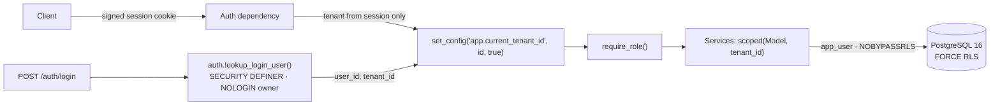

# fastapi-multitenant-rls

[](https://github.com/raullucena-dev/fastapi-multitenant-rls/actions/workflows/ci.yml)
[](https://github.com/raullucena-dev/fastapi-multitenant-rls/actions/workflows/ci.yml)


[](LICENSE)

A multi-tenant SaaS backend for a retail and inventory domain: tenants, users, products,
a stock ledger and sales. Tenant isolation is enforced **twice**, in the application and
in PostgreSQL with Row-Level Security, and the test suite proves each layer on its own.

## Live demo

> **Demo:** <https://pos-web-281796293339.us-east1.run.app> (React point-of-sale UI,
> [pos-demo-react](https://github.com/raullucena-dev/pos-demo-react))
>
> **API:** <https://pos-api-281796293339.us-east1.run.app>
>
> The demo runs on Google Cloud Run with Neon (PostgreSQL 16) and a React point-of-sale
> frontend that reaches the API through its own nginx on the same origin. It has two
> fictitious stores; logging into one never shows the other's data. Credentials are
> shown on the login page (from
> [`GET /demo/info`](https://pos-api-281796293339.us-east1.run.app/demo/info)), and all
> data is fictitious and periodically reset. Both services scale to zero, so the first
> request may take a few seconds. How it is deployed: [docs/deploy.md](docs/deploy.md).
>
> Or call the API directly:
>
> ```bash
> API=https://pos-api-281796293339.us-east1.run.app
> curl -c jar -H 'content-type: application/json' \
>   -d '{"username":"north.cashier","password":"demo1234"}' "$API/auth/login"
> curl -b jar "$API/products?limit=5"    # only Demo Store North's products
> ```

## Why it matters

In a shared-schema multi-tenant system, one query that forgets
`WHERE tenant_id = ...` leaks one customer's data to another. Code review is not a
control you can measure. This project treats isolation as a property of the system:

- **The database refuses** to return or accept another tenant's rows, even when the
  application gets a query wrong.
- **The application never trusts the client** about the tenant. The tenant comes only
  from a signed, server-side-revocable session, and any id in a payload is resolved
  inside the caller's tenant (`404` otherwise).
- **Failure is safe.** With no tenant context, queries return zero rows. They do not
  raise errors and they never return everything.

## Architecture



More detail: [docs/architecture.md](docs/architecture.md).

| Layer | Mechanism |
| --- | --- |
| HTTP | Tenant derived only from the signed session cookie. Foreign ids in payloads return `404`. |
| Application | Every query goes through `scoped(Model, tenant_id)`. |
| Database | `ENABLE` + `FORCE ROW LEVEL SECURITY` with `USING` and `WITH CHECK` on every tenant table. Policies read `NULLIF(current_setting('app.current_tenant_id', true), '')::int`. |
| Schema | Composite foreign keys `(tenant_id, x_id) -> parent(tenant_id, id)` make cross-tenant references impossible. |
| Roles | API connects as `app_user` (not superuser, not owner, `NOBYPASSRLS`). Migrations run as `app_owner`. Login lookup runs as the `NOLOGIN` role `app_auth`. |

## Quickstart

Requirements: Docker with the compose plugin. For running tests on the host you also
need [uv](https://docs.astral.sh/uv/).

```bash
make up        # postgres 16 + migrations + API on http://localhost:8000 (docs at /docs)
make seed      # two demo tenants, password: demo-password-123
```

Try it out:

```bash
curl -c jar -H 'content-type: application/json' \
  -d '{"username":"alpha-manager","password":"demo-password-123"}' localhost:8000/auth/login
curl -b jar localhost:8000/products                    # only Demo Tenant Alpha's catalogue
curl -b jar -H 'content-type: application/json' \
  -d '{"items":[{"product_id":1,"quantity":2}]}' localhost:8000/sales
curl -b jar "localhost:8000/reports/sales?date_from=2026-01-01&date_to=2026-12-31"
```

Without `make`: `docker compose up -d --build`, then
`docker compose run --rm migrate python -m app.cli seed-demo`.

| Command | What it does |
| --- | --- |
| `make up` / `make down` | Start the stack / stop it and drop the volume |
| `make migrate` | `alembic upgrade head` as `app_owner` |
| `make test` | Full test suite with coverage against the compose database |
| `make lint` | `ruff check`, `ruff format --check`, `mypy --strict` |
| `python -m app.cli create-tenant ...` | Provision a tenant and its first admin |

## API overview

| Endpoint | Roles |
| --- | --- |
| `POST /auth/login`, `POST /auth/logout`, `GET /auth/me` | any (login is public) |
| `GET /products`, `GET /products/{id}` | admin, manager, cashier |
| `POST /products`, `PATCH /products/{id}` | admin, manager |
| `DELETE /products/{id}`: hard delete, or soft delete when sales or stock history references it | admin |
| `GET/POST /stock-movements`, `DELETE /stock-movements/{id}` (appends a reversal) | admin, manager |
| `POST /sales` (atomic stock decrement), `GET /sales`, `GET /sales/{id}` | all; cashiers see only their own sales |
| `GET /reports/sales?date_from&date_to[&cashier_id]` | admin, manager |
| `GET/POST /users`, `GET/PATCH /users/{id}` | admin (manager can read) |
| `GET /audit-log` | admin |
| `GET /health` | public |
| `GET /demo/info` (only when `DEMO_MODE=true`) | public |

Auth details: bcrypt password hashes; a signed (itsdangerous) `HttpOnly`,
`SameSite=Lax` (configurable) session cookie holding a random token whose SHA-256 is
stored server-side; 5 failed attempts lock the account for 15 minutes; logout,
deactivation and password changes revoke sessions. With `DEMO_MODE=true`, failed logins
throttle only the client IP + username for a short window, so visitors can't lock the
shared demo accounts. Logins and writes are also rate-limited per IP (see
[docs/deploy.md](docs/deploy.md#demo-mode-in-short)).

## How tenant isolation is proven by tests

The tests run against real PostgreSQL 16 with the same roles as production, and
migrations are applied down to base and back up at the start of every run.

| Claim | Test |
| --- | --- |
| Tenant A cannot read, update or delete tenant B's products, stock movements, sales or users through any endpoint (`404`), and B's data stays unchanged | `tests/test_tenant_isolation.py` |
| A payload with a foreign `product_id` or `cashier_id` returns `404` and writes nothing | `test_sale_with_foreign_product_returns_404_and_changes_nothing`, `test_sale_with_foreign_cashier_id_returns_404` |
| `tenant_id` in the body, query string or headers has no effect | `test_tenant_cannot_be_chosen_via_payload`, `test_tenant_header_or_query_has_no_effect` |
| **Raw SQL with no tenant set returns 0 rows** on every tenant table, for the app role and for the table owner | `tests/test_rls.py::test_no_tenant_set_returns_zero_rows` |
| Inserting or moving rows into another tenant violates `WITH CHECK` | `test_insert_for_another_tenant_violates_with_check`, `test_update_cannot_move_rows_to_another_tenant` |
| Setting reverts to `''` on a pooled connection: the `NULLIF` policy returns 0 rows while a bare `::int` raises | `test_guc_reverts_to_empty_string_and_nullif_keeps_it_safe` |
| The application layer filters even when RLS is bypassed (superuser) | `test_service_layer_scopes_queries_even_when_rls_is_bypassed` |
| Every table is `FORCE`d, `tenant_id` is `NOT NULL`, and every policy uses `NULLIF` (catalogue check) | `test_every_tenant_table_has_forced_rls_and_not_null_tenant` |
| The login function is `SECURITY DEFINER`, owned by a `NOLOGIN` role, returns only `(user_id, tenant_id)` and cannot read password hashes | `test_login_lookup_exposes_no_secrets`, `test_definer_role_cannot_read_password_hashes` |
| A correctly signed cookie with a swapped tenant id finds no session | `test_valid_token_with_swapped_tenant_finds_no_session` |
| Lockout after 5 failures for 15 minutes; wrong role gets `403` | `tests/test_auth.py`, `tests/test_roles.py` |
| Concurrent sales never oversell | `test_concurrent_sales_never_oversell` |
| Models and migrations do not drift; `tenant_id` backfill works on real data | `tests/test_migrations.py` |

CI runs lint, strict mypy and the full suite with a coverage gate of 85% (the current
figure is in the badge), plus a `docker compose` smoke test that logs in as one tenant
and checks that the other tenant's catalogue is not visible.

## Tech decisions

| Decision | Why | ADR |
| --- | --- | --- |
| RLS in addition to app-level filtering | Defence in depth: one forgotten `WHERE` must not become a breach | [0001](docs/adr/0001-rls-in-addition-to-app-filtering.md) |
| `NULLIF(current_setting(..., true), '')::int` | Unset or reset tenant means 0 rows, not a 500 | [0002](docs/adr/0002-nullif-cast-for-tenant-setting.md) |
| `SECURITY DEFINER` login lookup owned by a `NOLOGIN` role | Login works before the tenant is known, without `BYPASSRLS` | [0003](docs/adr/0003-security-definer-login-bootstrap.md) |
| Single login domain, globally unique usernames | One trusted source for the tenant (the session), no `Host` header confusion | [0004](docs/adr/0004-single-login-domain.md) |
| Alembic owns policies, grants and functions; expand/contract deploys | Isolation changes are versioned, tested and deployed in a safe order | [0005](docs/adr/0005-migration-strategy.md) |
| `set_config(..., true)` rather than `SET LOCAL` | Takes bind parameters and is transaction-scoped, so it is safe with connection pools | [0001](docs/adr/0001-rls-in-addition-to-app-filtering.md) |
| Synchronous SQLAlchemy 2.x + psycopg 3 | Typed ORM, simple transaction semantics; FastAPI runs sync endpoints in a thread pool | |
| Append-only stock ledger with compensating reversals | Inventory history is auditable; "delete" never rewrites the past | |

See also [docs/migrations.md](docs/migrations.md), which covers the
nullable, backfill, `NOT NULL` pattern and the RLS gotchas found while building this, and
an example [postmortem](docs/postmortem-example.md) on enabling RLS before the matching
code was deployed.

## Project structure

```
app/
  api/          routes, dependencies (auth, require_role), middleware
  core/         settings, security (bcrypt, signed cookies), JSON logging, errors
  db/           engine/session, per-transaction tenant binding
  models/       SQLAlchemy 2.x typed models
  schemas/      Pydantic v2 request/response models
  services/     business logic; every query tenant-scoped
  cli.py        tenant provisioning, demo seed, reset-demo
  demo.py       public demo stores and the reset job
migrations/     Alembic revisions: schema, RLS + grants, login function, tenant_id backfill
scripts/        bootstrap_roles.sql: roles + databases (superuser or managed owner such as Neon)
db/             docker init hook
tests/          pytest suite against real PostgreSQL
docs/           architecture, ADRs, migrations guide, deployment, postmortem
```

## Configuration

All settings come from environment variables (see [.env.example](.env.example)), loaded
with pydantic-settings. The repository contains no real secrets. Credentials in
`docker-compose.yml` are development placeholders. In production, set `SECRET_KEY`,
`COOKIE_SECURE=true` and distinct database passwords from your secret manager, and use
`ENVIRONMENT=production` to disable the interactive docs. Production refuses to start
without a secure cookie and a real secret key.

## Deployment

[docs/deploy.md](docs/deploy.md) has the exact `gcloud` commands for the public demo:

- Artifact Registry and Secret Manager.
- The API as a Cloud Run service (`$PORT`, one worker per vCPU, small DB pool, trusted
  proxy headers).
- Migrations and the nightly demo reset as Cloud Run Jobs, with the reset triggered by
  Cloud Scheduler.
- A Neon database bootstrapped with `scripts/bootstrap_roles.sql`, which runs without
  superuser rights.

CI runs the whole suite against roles created both by a real superuser and by an
emulated managed-Postgres owner.

## License

[MIT](LICENSE)

---

## Resumen en español

**fastapi-multitenant-rls** es un backend SaaS multi-tenant (comercio minorista e
inventario: productos, movimientos de stock, ventas e informes) construido con FastAPI,
SQLAlchemy 2, Alembic y PostgreSQL 16. El aislamiento entre tenants se aplica en dos
capas independientes. En la aplicación, cada consulta se filtra por el tenant de la
sesión autenticada y nunca por datos del payload. En la base de datos, Row-Level Security
usa `FORCE` y una conversión `NULLIF(...)::int`, de modo que una consulta sin tenant
devuelve 0 filas en lugar de un error. El login funciona antes de conocer el tenant
gracias a una función `SECURITY DEFINER` mínima cuyo propietario es un rol `NOLOGIN`. La
suite de tests, que corre contra PostgreSQL real, demuestra que un tenant no puede leer,
modificar ni borrar datos de otro, y que SQL directo sin tenant devuelve 0 filas. Para
arrancarlo: `make up && make seed`.
