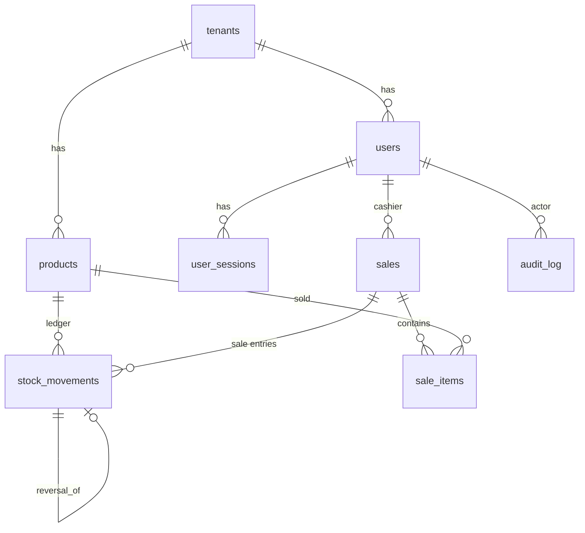

# Architecture

## Request flow

```mermaid
flowchart LR
    C[Client] -->|HTTPS + signed session cookie| MW[Request middleware<br/>request id, JSON log]
    MW --> R[FastAPI route]
    R --> A[get_auth_session<br/>verify signature + TTL]
    A -->|tenant_id from cookie| T["bind_tenant()<br/>set_config('app.current_tenant_id', id, true)"]
    T --> S[(user_sessions<br/>RLS-protected lookup)]
    S -->|active session + user| RR["require_role()"]
    RR -->|403 if role not allowed| X[Error handler]
    RR --> SV[Service layer<br/>scoped(Model, tenant_id)]
    SV -->|app_user, NOBYPASSRLS| DB[(PostgreSQL 16<br/>FORCE ROW LEVEL SECURITY)]
    DB --> P{{"policy tenant_isolation<br/>tenant_id = NULLIF(current_setting(...), '')::int"}}

    L[POST /auth/login] --> F["auth.lookup_login_user(username)<br/>SECURITY DEFINER, owner app_auth NOLOGIN"]
    F -->|user_id, tenant_id only| T
```

Tenant context is set from one place: the signed session cookie. After `bind_tenant()`,
every transaction on that SQLAlchemy session starts by setting the transaction-local
setting (an `after_begin` event in `app/db/tenant.py`), so a commit in the middle of a
request does not drop the context.

## Database roles

| Role | Login | Owns | Used by | Notes |
| --- | --- | --- | --- | --- |
| `app_owner` | yes | all tables, sequences | Alembic, CLI provisioning | Not superuser. Subject to RLS because of `FORCE`. |
| `app_user` | yes | nothing | the API | `NOBYPASSRLS`. Only the DML each table needs (e.g. `audit_log` is `SELECT, INSERT`). |
| `app_auth` | **no** | schema `auth`, `lookup_login_user()` | login bootstrap | Can read only `id, tenant_id, username` from `users`. |

## Isolation layers

| Layer | Mechanism | Proven by |
| --- | --- | --- |
| HTTP | Tenant only from the signed cookie; payload ids resolved within the tenant, 404 otherwise | `tests/test_tenant_isolation.py` |
| Application | `scoped(Model, tenant_id)` on every query | `test_service_layer_scopes_queries_even_when_rls_is_bypassed` (runs as superuser) |
| Database | `FORCE` RLS with `USING` + `WITH CHECK`, fail-closed `NULLIF` cast | `tests/test_rls.py` (raw SQL, no app code) |
| Schema | Composite FKs `(tenant_id, x_id) -> parent (tenant_id, id)` | Cross-tenant references are rejected by PostgreSQL |

## Data model



Every table except `tenants` has `tenant_id NOT NULL`. `tenants` is itself protected by
RLS on `id`.

## Domain rules

- **Products**: hard delete if never referenced. If a sale or stock movement references
  the product, it is soft-deleted (`deleted_at`), which hides it and frees its SKU
  (partial unique index `WHERE deleted_at IS NULL`).
- **Stock movements** form an append-only ledger. `DELETE /stock-movements/{id}` appends a
  compensating `reversal` entry and marks the original `reversed_at`. Sale and reversal
  entries cannot be reversed, and no reversal may take stock below zero.
- **Sales** lock every product row involved with `SELECT ... FOR UPDATE`, in id order to
  avoid deadlocks. Stock checks, decrements, sale items, ledger entries and the audit
  entry are written in one transaction. A `CHECK (stock_quantity >= 0)` constraint is the
  final guard. `tests/test_sales.py::test_concurrent_sales_never_oversell` races six
  requests for three units.
- **Audit log** entries are written in the same transaction as the change they describe,
  so they cannot disagree with it. The app role cannot `UPDATE` or `DELETE` them.

## Observability

- One JSON log line per request (`request.completed`) with `request_id`, method, path,
  status, duration, `tenant_id` and `user_id`.
- `X-Request-ID` is accepted when it is well formed (otherwise generated) and echoed back.
- `GET /health` checks database connectivity and returns `503` when it fails.
